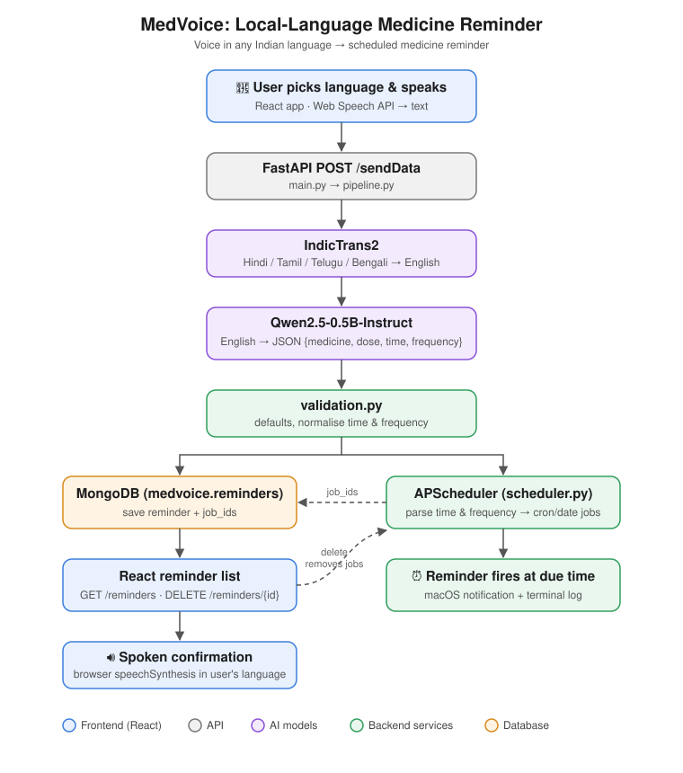
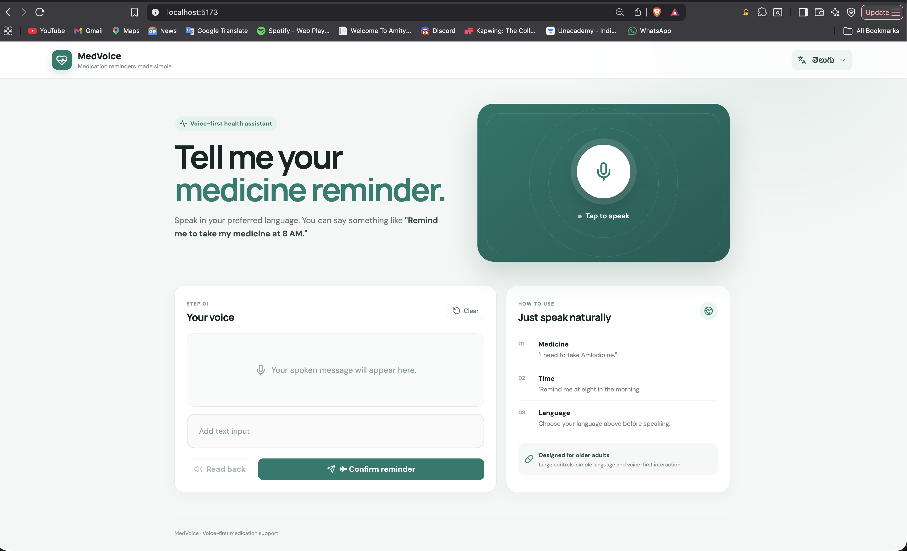
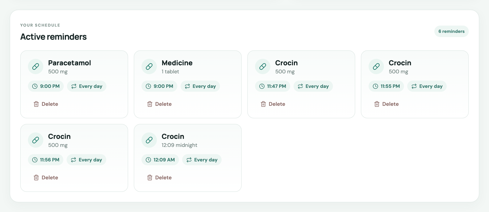
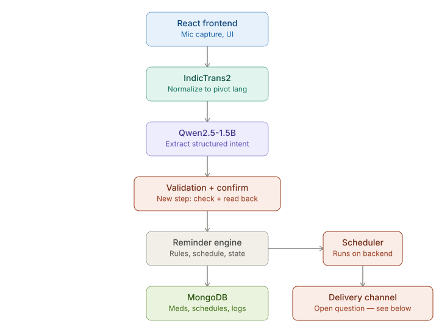
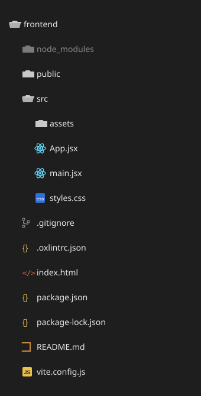
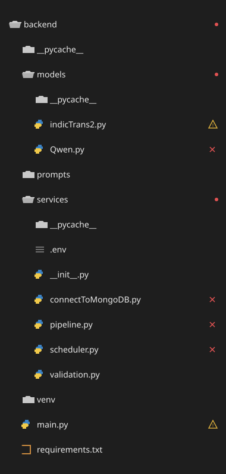

<div align="center">

# 🩺 Local Language Elderly Reminders for elderly users: NLP/AI system designed for voice-first, multilingual medication support

An AI-powered medication reminder system for elderly users: NLP/AI system designed for voice-first, multilingual medication support

[](https://huggingface.co/spaces/Lkkash/Local_language_elderly_reminders)

</div>

<b>V1.1</b> - adds a huggingface space link for a live demo of the backend <br>

AI models which I’ve chosen :
<b> IndicTrans2 (Local language to English) — </b> using it as a pivot-language normalizer (local language → English/Hindi → back) 
makes sense given Qwen2.5's Indic-language support is comparatively weak versus English. Keep this, 
but be aware every added hop (ASR→MT→LLM→MT→TTS) adds latency — for elderly users expecting a conversational feel, 
test end-to-end latency early, not at the end.

<b> Qwen2.5-0.5B (English to JSON query) - </b> Instruct for intent extraction. I switched from 1.5B to 0.5B because 1.5B didn't fit in
8 GB of RAM (it was partly offloaded to disk and took minutes to start). 0.5B in float16 is ~1 GB, loads in seconds and answers in ~1.3s.
With a chat-format prompt, worked examples and rule-based frequency (see Qwen.py and validation.py below), 0.5B scored 8/10 on my
test sentences, the same as 1.5B at half the time. It is fine for structured JSON extraction, but for a medical use case,
don't trust it blind. Add a validation/confirmation layer: schema-check the extracted fields (drug name against
a known list, dose within sane bounds, time in valid format), and always read the parsed entry back to the user 
via TTS for confirmation before writing to MongoDB. Medicine-name misrecognition is the single biggest safety risk 
in this pipeline — ASR errors on drug names are common and consequences are real.

<b> Working of the Front page using React — </b> A React webpage only works while someone has it open in a browser tab. Elderly users won't 
keep a tab open waiting for reminders. You need a backend scheduler (e.g., node-cron or a Celery/APScheduler job) 
that fires independently of the browser and pushes the reminder through a channel that reaches them passively — a phone call 
(IVR-style, reusing your TTS), SMS, or WhatsApp, not just an in-page notification.  (Implemented so far: an APScheduler
scheduler in the backend that fires a macOS notification at the reminder time, even when the browser tab is closed. Phone call / SMS / WhatsApp are not done yet.)

## How it works

<p align="center">
  
</p>

1. The user picks a language (Hindi, Tamil, Telugu or Bengali) on the slider and speaks. The browser's Web Speech API turns it into text.
2. React sends the text and the language to FastAPI (`POST /sendData`).
3. IndicTrans2 translates it to English.
4. Qwen2.5-0.5B extracts `{medicine, dose, time, frequency}` as JSON.
5. `validation.py` fills defaults and normalises the time and frequency so the scheduler can understand them.
6. The reminder is saved in MongoDB and APScheduler creates the timed jobs; the job IDs are saved back on the reminder.
7. At the reminder time a macOS notification pops up. React lists saved reminders (`GET /reminders`) and can delete them (`DELETE /reminders/{id}`), which also cancels their jobs.

## Frontend Image:

<p align="center">
  
</p>

### Active reminders

Saved reminders from MongoDB, shown on the page with their dose, time and frequency, and a Delete button that also cancels their scheduled jobs.

<p align="center">
  
</p>


## Architecture

<p align="center">
  
</p>

<br>
<b>Reminder Engine - </b> This is the business logic layer. It doesn't run on a timer itself, it's the code that:
<li> Takes validated intent from the LLM step (e.g. "remind me to take metformin at 8am and 8pm daily") and turns it into structured records </li>
<li> Applies rules: handling recurring schedules, time zones, "take with food" style conditions, skip/snooze logic, dose adjustments  </li>
<li> Talks to MongoDB to persist and update medicine/schedule/log data  </li>
<li> Exposes functions like createReminder(), markTaken(), getUpcomingReminders(), escalateIfMissed() </li>
<br>

<b>Scheduler (scheduler.py) - </b> Scheduler triggers reminders at the right wall-clock time. It periodically (or via cron-like triggers) 
asks the reminder engine "what's due right now?" and kicks off the delivery flow (call/SMS/TTS).

## Scheduler (scheduler.py)

The scheduler runs inside the FastAPI backend using **APScheduler's `BackgroundScheduler`**, a background thread that keeps a list of
timed jobs and runs each one at its time. It works even when the React tab is closed, as long as the backend is running.

| Part | What it does |
|---|---|
| `scheduler = BackgroundScheduler()` | Creates the scheduler. `main.py` also uses it to remove jobs when a reminder is deleted. |
| `start_scheduler()` / `stop_scheduler()` | Start the scheduler thread (called from `main.py` on startup) / shut it down. |
| `send_mac_notification()` | Shows a native **macOS notification** with a sound, using `osascript` (AppleScript). Quotes in medicine names are escaped so they can't break the script. |
| `reminder_function(medicine, dose)` | What runs at the reminder time: prints a reminder box in the terminal and sends the macOS notification ("Take 1 tablet of Crocin right now"). |
| `parse_time()` | Turns human times into `(hour, minute)`: `"8:00 PM"`, `"8 PM"`, `"8 p.m."`, `"20:00"` → `(20, 0)`. |
| `parse_frequency()` | Understands `daily` / `every day` / `every morning`, `every monday` … `every sunday`, `next 3 days`, `next 4 months`. |
| `schedule_reminder()` | Creates the jobs for one reminder and returns their job IDs, which `pipeline.py` saves on the MongoDB document. |

How each frequency is scheduled:

| Frequency | Jobs created |
|---|---|
| `daily` | one `cron` job every day at that time (`<id>_daily`) |
| `every monday` | one `cron` job on that weekday (`<id>_weekly`) |
| `next N days` | N one-time `date` jobs, one per day (`<id>_day_0` … `<id>_day_N-1`) |
| `next N months` | one daily `cron` job with a start and end date (`<id>_monthly`) |

Deleting a reminder from the app (`DELETE /reminders/{id}`) removes its jobs using the saved job IDs, then deletes the MongoDB document.

You can test the scheduler on its own with `python services/scheduler.py` (from `backend/`); it schedules a test reminder.

**Known limitations:**
- Jobs live in memory only, so restarting the backend clears all scheduled jobs (the reminders stay in MongoDB but stop firing).
  Fix: reload active reminders from MongoDB on startup, or use a MongoDB job store.
- For `next N days`, if today's time has already passed, two reminders land on the same day and the last day is skipped.
- Notifications only appear on the Mac running the backend (macOS only).

## Validation (validation.py)

Takes Qwen's JSON and makes it safe for the scheduler:
- Converts numbers, `null` and lists to text (e.g. dose `500` → `"500"`).
- Fills missing fields with defaults: `"medicine"`, `"1 tablet"`, `"9:00 PM"`, `"daily"`.
- Maps time words to clock times: morning → 8:00 AM, afternoon → 2:00 PM, evening → 6:00 PM, night → 9:00 PM.
- Works out the frequency with rules instead of trusting Qwen: looks for "next N days/months" and weekday names in Qwen's answer
  and in the translated sentence, otherwise uses `daily`.
- Checks the time and frequency with the scheduler's own `parse_time` / `parse_frequency`. If they can't be understood it returns
  `valid: False` with a message (e.g. *I couldn't understand the time "after lunch"*), which the app shows in its error box.

## Guide to run the project:

1) open frontend folder and run npm run dev
2) open backend folder and run a) pip install -r requirements.txt b) uvicorn main:app --reload
3) open terminal and run brew services start mongodb-community
4) change source to venv -> source venv/bin/activate
5) change other source to conda for indicf5 -> conda activate indicf5

# Requirements.txt:

```python
fastapi
uvicorn[standard]
python-multipart
transformers==4.51.3
torchaudio
"onnxruntime==1.20.1"
"onnx==1.20.1"
"onnxruntime-gpu==1.20.1"
sentencepiece
torch
numpy
soundfile
indictranstoolkit
"accelerate>=1.10"
apscheduler
python-dateutil
pymongo
python-dotenv
bson
datetime
```

## Text Recognition
For the text recognition, i've used the google built-in Web Speech API (SpeechRecognition) which captures the voice.
The voice is then converted to text in finalVariable, and later stored in the <b>transcript</b> variable. 

The language slider at the top of the page (हिन्दी / தமிழ் / తెలుగు / বাংলা) sets both the speech-recognition language and the
language IndicTrans2 translates from. It's locked while the app is listening or processing.

## Frontend and Backend Architecture

<p align="center">
  
  
</p>

### Qwen.py (if you want to run locally):

[`backend/models/Qwen.py`](backend/models/Qwen.py) loads **`Qwen/Qwen2.5-0.5B-Instruct`** and turns the English sentence into JSON.

- **Precision:** `float16` (`bfloat16` on a CUDA GPU that supports it), about 1 GB, so it fits in 8 GB of RAM.
- **Prompt:** uses the model's chat format (`tokenizer.apply_chat_template`) with
  - a system prompt that defines each field and its exact format (`time` like `"9:00 PM"`, `frequency` one of `daily`, `every monday`, `next N days`, `next N months`),
  - 3 worked examples given as earlier chat turns.
- **Output:** `max_new_tokens = 80` (the JSON is ~40 tokens). The first `{...}` block in the reply is parsed as JSON.
- **Time estimate:** prints an estimated time before each query (based on earlier queries), a live `tokens | tok/s | ~Ns left`
  line while generating, and the actual time at the end. The last timing is kept in `Qwen.last_run`.

Example terminal output:
```
Qwen: estimated time ~2s
Qwen: prompt processed in 0.3s, generating...
Qwen: 22 tokens | 28.4 tok/s | ~0s left
Qwen: finished in 1.3s (35 tokens)
```

Accuracy on 10 test sentences (fully correct after validation):

| Model | Old plain prompt | Chat prompt + examples | + rule-based frequency |
|---|---|---|---|
| 0.5B | 1/10 | 5/10 | **8/10** |
| 1.5B | 2/10 | 8/10 | 8/10 (about 2× slower) |

<br>

### indicTrans2.py (if you want to run locally):

[`backend/models/indicTrans2.py`](backend/models/indicTrans2.py) loads **`ai4bharat/indictrans2-indic-en-dist-200M`** and translates
the user's sentence to English. The source language comes from the language slider in the app:

| App language | Code sent by React | IndicTrans2 code |
|---|---|---|
| हिन्दी Hindi | `hi-IN` | `hin_Deva` |
| தமிழ் Tamil | `ta-IN` | `tam_Taml` |
| తెలుగు Telugu | `te-IN` | `tel_Telu` |
| বাংলা Bengali | `bn-IN` | `ben_Beng` |

`translate_to_english(text, src_lang)` takes the language as a parameter (it used to be hardcoded to Tamil, which turned Hindi
into untranslated text). An unsupported language returns a clear error instead of crashing.

### pipeline.py and errors

[`backend/services/pipeline.py`](backend/services/pipeline.py) runs translate → Qwen → validate → save + schedule, and always
returns `{"success": ..., "message": ...}`. If anything fails, `/sendData` returns `success: false` with a readable message
(shown in the app) instead of a 500 error. A 500 has no CORS headers, so the browser used to report it as a "CORS error".
If scheduling fails after the reminder is saved, the saved reminder is deleted again.

## Running the project

Start MongoDB, then the backend, wait for `Application startup complete`, then the frontend:

```bash
cd backend && venv/bin/uvicorn main:app
```

```bash
cd frontend && npm run dev
```

Open `http://localhost:5173` (not `127.0.0.1:5173`, CORS only allows `localhost`). The app retries loading reminders every 2s
until the backend is ready, and calls the API on `http://127.0.0.1:8000`.

- **First run / model downloads:** if a Hugging Face download is stuck at 0%, disable the Xet backend:
  `HF_HUB_DISABLE_XET=1 venv/bin/uvicorn main:app`
- **Don't use `--reload`** while testing reminders: every reload restarts the server and clears scheduled jobs.
- **macOS notifications:** allow notifications for *Script Editor* in System Settings → Notifications.

## Database (MongoDB):

All the JSON queries are being stored in the backend with database being medvoice and collection being the reminders. The JSON queries look as:

```python
{
  _id: ObjectId('id'),
  medicine: 'Crocin',
  dose: '1 tablet',
  time: '9:00 PM',
  frequency: 'daily',
  original_message: 'रात 9 बजे क्रोसिन लेने की याद दिलाना',   # what the user said
  status: 'active',
  created_at: ISODate('...'),
  job_ids: ['<id>_daily']   # scheduler jobs, used to cancel them on delete
}
```

The saved reminders appear on the page in a "Your schedule" panel: one card per reminder with the medicine, dose, time and
frequency, and a Delete button that removes the reminder and cancels its scheduled jobs.

## Language Presets:

| Language | Script (letters, symbols, characters) | Preset Code |
|----------|--------|-------------|
| Assamese | Bengali | `asm_Beng` |
| Bengali | Bengali | `ben_Beng` |
| Bodo | Devanagari | `brx_Deva` |
| Dogri | Devanagari | `doi_Deva` |
| English | Latin | `eng_Latn` |
| Konkani | Devanagari | `gom_Deva` |
| Gujarati | Gujarati | `guj_Gujr` |
| Hindi | Devanagari | `hin_Deva` |
| Kannada | Kannada | `kan_Knda` |
| Kashmiri | Arabic | `kas_Arab` |
| Kashmiri | Devanagari | `kas_Deva` |
| Maithili | Devanagari | `mai_Deva` |
| Malayalam | Malayalam | `mal_Mlym` |
| Marathi | Devanagari | `mar_Deva` |
| Manipuri | Bengali | `mni_Beng` |
| Manipuri | Meitei | `mni_Mtei` |
| Nepali | Devanagari | `npi_Deva` |
| Odia | Odia | `ory_Orya` |
| Punjabi | Gurmukhi | `pan_Guru` |
| Sanskrit | Devanagari | `san_Deva` |
| Santali | Ol Chiki | `sat_Olck` |
| Sindhi | Arabic | `snd_Arab` |
| Sindhi | Devanagari | `snd_Deva` |
| Tamil | Tamil | `tam_Taml` |
| Telugu | Telugu | `tel_Telu` |
| Urdu | Arabic | `urd_Arab` |


